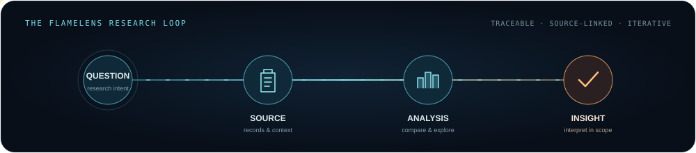

<div align="center">
  

  <br />

  <h1>FlameLens</h1>
  <p><strong>Explore the science of fire beyond Earth.</strong></p>
  <p>An interactive research workspace for navigating NASA combustion investigations, comparing experimental evidence, and learning how fire behaves in spaceflight environments.</p>

  <p>
    <a href="https://github.com/amimishra990-cpu/FlameLens"></a>
    
    
    
  </p>

  <p><a href="#explore-the-workspace">Workspace</a> · <a href="#technical-methods">Technical methods</a> · <a href="#research-data">Research data</a> · <a href="#get-started">Get started</a></p>
</div>

---

## About FlameLens

Fire behaves differently as gravity, airflow, fuel, pressure, and experimental hardware change. FlameLens brings these factors into view through an interactive interface built around public spaceflight combustion research. It helps students, researchers, and curious readers move from a question to the relevant investigation, inspect what its records contain, and compare evidence in context.

The workspace connects NASA Physical Sciences Informatics (PSI) investigations on flame extinction, solid-fuel flame spread, soot and smoke-point behavior, and smoke or aerosol detection. Searchable source records, interactive analysis, visual experiments, and short learning scenarios make the research easier to explore while keeping the path back to the evidence visible.

FlameLens is an independent research and learning project. It is not a NASA product, and NASA’s inclusion as a source does not imply NASA endorsement.

## Explore the workspace

| Workspace | What it does |
| --- | --- |
| **Investigation Explorer** | Search and filter the research catalogue by topic, source availability, data type, and research intent. Inspect investigation goals, hardware and experiment context, local file coverage, source links, relevance evidence, and known gaps. |
| **Comparison Lab** | Select up to three investigations and compare their conditions side by side. Explore shared numeric fields with unit-aware views, inspect row-level values, and see where measurement definitions and experimental contexts affect comparability. |
| **Model Lab** | Explore research-specific virtual experiments for flame extinction, flame spread, and smoke-point behavior. Adjust conditions, run local batches, inspect supporting records and analysis methods, review data coverage and applicability, and export a track-specific audit report. |
| **Research Copilot** | Ask about indexed investigations and project methods. Follow answers to retrieved source passages, inspect their locators, and explore a source trail related to the question. |
| **Mission Deck** | Work through three fictional evidence scenarios with Mica, the animated field guide. Each challenge focuses on interpreting an event label, a gravity regime, or a measurement target. |
| **Overview** | Get a visual introduction to the research areas and the tools available for exploring them. |

### A typical research journey

1. **Start with a question.** Search the Explorer for an investigation, material, measurement, or research theme.
2. **Read the source context.** Check the experiment objective, conditions, fields, and available files before interpreting a value.
3. **Compare carefully.** Use the Comparison Lab to inspect shared fields and see how units, methods, and source definitions affect the comparison.
4. **Explore a research track.** Set virtual experiment conditions, run a batch, and inspect the method, nearby observations, and domain information alongside the output.
5. **Follow the evidence.** Ask the Copilot or try a Mission Deck scenario, then open the linked source passages and investigation records.

<div align="center">
  
</div>

## Technical methods

The Model Lab uses different methods for each research question. A shared interface presents their assumptions and evidence together, but the tracks do not share one universal target or one interchangeable model.

### 1. FLEX flame-extinction track

The FLEX workspace reads complete rows from the PSI-69 local table and uses fuel, ambient pressure, initial oxygen mole fraction, and droplet diameter to find nearby cases. Each numeric feature is scaled by its observed range. The normalized distance to case \(i\) is:

$$
d_i = \sqrt{\frac{1}{3}\left[\left(\frac{p_i-p_q}{R_p}\right)^2 + \left(\frac{Y_{O_2,i}-Y_{O_2,q}}{R_{O_2}}\right)^2 + \left(\frac{D_i-D_q}{R_D}\right)^2\right]}
$$

Here \(p\) is ambient pressure, \(Y_{O_2}\) is initial oxygen mole fraction, \(D\) is initial droplet diameter, \(R_j\) is the observed range for feature \(j\), and \(q\) denotes the query. The search uses matching-fuel observations when available, otherwise it falls back to all eligible FLEX cases. It keeps the seven closest cases and weights each recorded `Test end` label by:

$$
w_i = \frac{1}{d_i + 0.035}, \qquad S(c\mid q)=\frac{\sum_{i\in N_7} w_i\,\mathbf{1}(y_i=c)}{\sum_{i\in N_7}w_i}
$$

The displayed result is the leading source label and its neighbor-weighted support. The labels retain the vocabulary of the source table; support is not a physical extinction probability. The batch evaluation omits the matching `FLEX Test #` from each query and reports accuracy and macro F1 over the remaining rows. The interface also shows the nearest source test identifiers.

### 2. BASS-II flame-spread track

The spread workspace uses measured PMMA points transcribed from NASA BASS-II Table 5.1. Query conditions are sample thickness \(t\), width \(b\), number of burning sides \(s\), and opposed-flow speed \(u\). Their scaled distance to observation \(i\) is:

$$
d_i = \sqrt{\frac{1}{4}\left[\left(\frac{t-t_i}{4\,\mathrm{mm}}\right)^2 + \left(\frac{b-b_i}{1\,\mathrm{cm}}\right)^2 + (s-s_i)^2 + \left(\frac{u-u_i}{19\,\mathrm{cm/s}}\right)^2\right]}
$$

The four nearest observations are combined using inverse-distance weights with a small stabilizing offset:

$$
w_i=\frac{1}{d_i+0.025}, \qquad \widehat{r}=\frac{\sum_{i\in N_4} w_i r_i}{\sum_{i\in N_4}w_i}, \qquad \widehat{T}_{100}=\frac{100\,\mathrm{mm}}{\widehat{r}}
$$

Here \(r_i\) is the measured spread rate in mm/s; \(\widehat{T}_{100}\) is the simple estimated time to traverse 100 mm. Evaluation leaves out the matching NASA test ID and reports MAE, RMSE, and \(R^2\). The input bounds and nearest test IDs are surfaced with each batch so users can see which observations support an estimate.

### 3. Published SPICE smoke-point correlation

For the SPICE track, FlameLens evaluates the published luminous smoke-point length relationship reported by Dotson, Sunderland, Yuan, and Urban (2011):

$$
L_{SP}=A_f\,d^{-0.910}\,u_{air}^{0.414}
$$

\(L_{SP}\) is luminous smoke-point length, \(d\) is burner diameter, \(u_{air}\) is coflow velocity, and \(A_f\) is the paper’s fuel factor. The published correlation uses 55 smoke-point measurements and reports \(R^2=0.90\). FlameLens samples coflow within the paper’s 5.4–65 cm/s domain and displays the paper-reported uncertainty (±5% length and ±10% air velocity) beside the estimate. This quantity represents luminous length; the interface keeps it distinct from soot fraction, smoke mass, and detector response.

| Fuel in the correlation | \(A_f\) |
| --- | ---: |
| Ethylene | 21.2 |
| Propane | 18.5 |
| Propylene | 6.05 |
| 75% propylene / N₂ | 7.65 |
| 50% propylene / N₂ | 13.9 |

**Reference:** [Dotson et al., *Fire Safety Journal* 46 (2011), 550–555](https://doi.org/10.1016/j.firesaf.2011.08.002).

### Batch sampling and reported metrics

Virtual experiment batches contain 5–100 cases. Where the interface sweeps a numeric condition, it uses a deterministic Halton low-discrepancy sequence (bases 2, 3, and 5 for the FLEX condition axes; base 2 for flow sweeps) and clamps requested values to the track’s supported range. This provides repeatable coverage of the selected interval without implying new physical observations. Evaluation statistics are reported alongside the scope and grouping used by that track.

## Research data and provenance

FlameLens organizes bundled NASA PSI tables by research area:

- **Flame extinction:** PSI-69 FLEX liquid-droplet cases and PSI-159 CFI-G normal and inverse flame records.
- **Flame spread:** PSI-25 BASS-II, PSI-99 SAFFIRE-II, and PSI-100 SAFFIRE-III records, with the separate BASS-II Table 5.1 transcription used by the PMMA spread experiment.
- **Soot and smoke point:** PSI-107 SPICE condition records and the separately cited published correlation.
- **Smoke and aerosol detection:** PSI-102 SAME records, kept distinct from soot-production and smoke-point questions.

The Explorer and Model Lab expose source metadata, field roles, units, row coverage, method notes, and relevant source links. The Comparison Lab indicates whether a selected field is available and comparable across the chosen records. The Research Copilot retrieves passages from the project’s local evidence index and links claims back to their source locations.

For the complete source inventory and file map, see [`data/README_DATA_MAP.md`](data/README_DATA_MAP.md). Additional methods, audit notes, comparison rules, and track-specific documentation are in [`data/`](data/).

## Get started

### Requirements

- Node.js
- npm

### Install and run

```bash
git clone https://github.com/amimishra990-cpu/FlameLens.git
cd FlameLens
npm install
npm run dev
```

Vite prints the local development URL in the terminal. To create and serve a production build:

```bash
npm run build
npm run preview
```

### Optional service configuration

Copy `.env.example` to `.env.local` to configure optional local services. Supabase URL and publishable key values enable email authentication. A server-side language-model API key can enable provider-generated Copilot summaries. Keep private keys in server-side environment variables; never expose them through a `VITE_` variable or commit them to the repository.

## Architecture and technology

| Layer | Implementation |
| --- | --- |
| User interface | React 18, TypeScript, and React Router |
| Development and build | Vite 6 |
| Interactive 3D | Three.js and locally bundled GLB assets |
| Source catalogue and analysis | Typed TypeScript modules with project CSV and research references |
| Authentication | Supabase Auth integration, configured optionally |
| Copilot evidence | Locally generated searchable source index, with optional provider summaries |
| Visual design | Responsive CSS, shared design tokens, and reduced-motion support |

## Repository map

```text
src/
  components/   Shared interface, navigation, 3D, and experiment controls
  data/         Investigation catalogue, comparison logic, methods, and evidence index
  pages/        Explorer, Comparison Lab, Model Lab, Copilot, and Mission Deck
  scenes/       Landing-page sections and visual scenes
  styles/       Page styles, responsive layout, and design tokens
data/
  source_data/  NASA source tables organized by research area
  research/     Research references and derived transcriptions
  processed/    Supporting project data
public/
  images/       Visual assets used in the application
  models/       3D assets
  readme/       Animated project and workflow illustrations
```

---

<div align="center">
  <sub>FlameLens · Combustion research, in context · Built for curious minds looking beyond Earth</sub>
</div>
