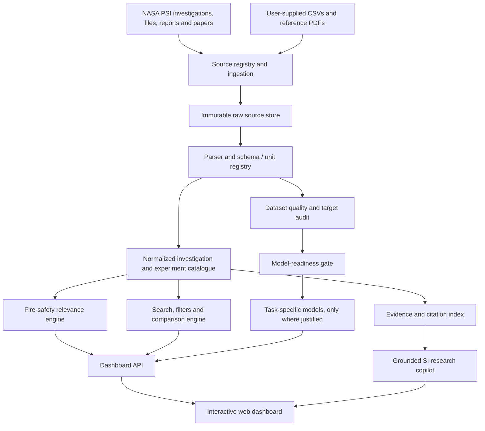

# Architecture

## FlameLens — NASA Fire-Safety Intelligence Dashboard

**Product class:** evidence-grounded research intelligence dashboard with a gated predictive-model layer.  
**Primary purpose:** make NASA microgravity combustion investigations easier to discover, compare, rank and interpret for spacecraft, station, lunar-habitat, pressurized-rover and future Mars fire-safety questions.

## 1. Product correction: dashboard first, predictors second

The NASA challenge is broader than the original three-model concept. The product must first answer questions such as:

- Which investigations are most relevant to prevention, detection or suppression in a crewed habitat?
- What material, fuel, burner, geometry, oxygen, pressure, airflow, sensor and hardware conditions were tested?
- Which tests differed within one investigation, and which are comparable across investigations?
- What evidence exists for an ISS cabin, spacecraft cabin, lunar base, pressurized rover or Mars transit habitat?
- What is missing from the available evidence?

The three ML tracks remain useful, but they are a capability within the research dashboard. Detection is also a first-class evidence domain even though it is not automatically a fourth trained model. Do not make the home page look like a prediction form with NASA data added as decoration.

## 2. Logical architecture

### 2.1 Source registry and ingestion

Every imported source receives a durable record containing:

- NASA PSI identifier, investigation title, version, DOI and official landing-page URL where available.
- Source file name, file checksum, media type, source folder, release/version date and retrieval date.
- Raw column names, source units, table notes, measurement provenance and license/citation metadata.
- Parse status, validation warnings and the exact parser version.

Support CSV first. Add PDF, image/video metadata and other PSI file types as separate ingestion adapters. Do not silently treat a document, image sequence or derived product as a tabular experiment table.

### 2.2 Immutable raw layer

`data/source_data/` is the immutable, physically segregated source layer. The supplied CSVs are each placed under one primary category folder: `01_flame_extinction/`, `02_flame_spread/`, `03_soot_smoke/` or `04_smoke_detection/`. Never overwrite source values, change original headings, remove repeated rows or normalize units in place. Record hashes and source encodings. Store interpreted/cleaned tables in a separate generated `data/processed/` layer with full provenance. Read `data/README_DATA_MAP.md` and the per-model readmes before using any CSV.

### 2.3 Normalized research catalogue

Use source-aware entities rather than one giant flattened CSV:

| Entity | Key fields |
|---|---|
| Investigation | PSI ID, title, objectives, research area, dates, platform, PI, DOI, version |
| Experiment/Test | investigation ID, test ID, sample ID, run grouping, test conditions |
| Fuel/Material | fuel/material identity, composition, form, sample geometry, source wording |
| Environment | gravity regime, oxygen, diluents, pressure, temperature, imposed flow |
| Hardware | facility, rack/glovebox, apparatus, burner/duct, diagnostic hardware |
| Measurement | measurement name, value, unit, method, time/position, uncertainty, pre/post-event status |
| Data asset | source file, file type, release, checksum, completeness, provenance |
| Evidence claim | statement, source passage/page, supporting investigation, evidence type, confidence/limitations |
| Relevance assessment | use case, scoring dimensions, score version, rationale and reviewer |

Keep the original field name and value alongside normalized name/value. A normalized field must be traceable back to one or more raw fields and a documented transform.

### 2.4 Relevance engine — the dashboard's main ranking feature

The challenge asks for investigations to be summarized and ranked by relevance to crew fire-safety needs. Implement a transparent, adjustable **Research Relevance Score**, not a hidden AI score and not a fire-risk score.

Recommended first-pass scoring dimensions (each rated 0–5 with a recorded rationale):

1. **Safety-need fit (25%)** — prevention, detection, suppression or a cross-cutting fire-safety need.
2. **Physical-phenomenon fit (20%)** — same phenomenon or a clearly stated adjacent mechanism.
3. **Environment fit (20%)** — relevant gravity, atmosphere, pressure, flow and habitat context.
4. **Measurement fit (15%)** — measurements useful to the selected question, with method and units known.
5. **Hardware / implementation transfer (10%)** — diagnostics, apparatus or controls with a credible use pathway.
6. **Evidence completeness (10%)** — usable metadata, accessible data products, traceable methods and documented limitations.

`Relevance = Σ(weight_i × normalized_dimension_i)`. Keep the dimension scores, weights, rationale, source evidence and score version visible. Allow the user to change weights for a chosen use case. A result must explain *why* it ranks highly and *what it does not prove*.

Default use-case profiles:

- **Prevention:** material flammability, ignition, flame growth/spread/extinction limits, oxygen sensitivity, material form and airflow.
- **Detection:** smoke/aerosol generation, particle size and transport, sensor response, sensor placement and background dust/aerosol discrimination.
- **Suppression:** droplet or gaseous flame extinguishment, suppressant/diluent effects, configuration, timing and limitations.
- **Habitat transfer:** relevance to spacecraft/station, lunar surface habitat, pressurized rover or Mars transit context. It must show the assumed environment and evidence gap.

For lunar/partial-gravity questions, keep **LUCI** as external NASA/NTRS evidence for simulated lunar gravity and **FM²** as a NASA data-release source to monitor. Do not claim either is one of the bundled PSI CSVs. Preserve gravity as a measured/time-varying field where available.

A high relevance rank means “worth examining for this research question.” It does **not** mean “this technology is safest,” “the hazard is higher,” or “NASA has approved this system.”

### 2.5 Search and comparison services

Search/filter by investigation, PSI ID, title, safety function, material/fuel, geometry, oxygen, pressure, airflow, gravity regime, hardware, diagnostic type, data availability and evidence type. Comparison aligns only semantically compatible variables. For every compared value, show source field, unit, conversion and missingness. Do not turn missing into zero.

### 2.6 Evidence-grounded SI layer

Treat “SI” as an evidence-grounded research copilot, not a claim of artificial general intelligence or an autonomous spacecraft safety authority.

Pipeline:

1. Parse the user's question into a research intent and environment/use-case profile.
2. Retrieve relevant investigation metadata, measured data, report passages and source citations.
3. Build an answer only from retrieved, versioned evidence plus explicitly labelled engineering interpretation.
4. Attach source-level citations to every factual finding and show the underlying investigation/file.
5. Expose contradictions, missing data, uncertain terms and outside-domain requests.
6. If evidence is insufficient, return “not established in the indexed PSI material” and suggest what source or measurement is missing.

The LLM must not fabricate an investigation, measurement, DOI, dataset value or causal explanation. Keep retrieved text and model-generated interpretation visibly distinct.

### 2.7 Predictive-model service (gated)

Model availability is determined by the dataset audit, not by whether a UI tab exists.

| Branch | Current design |
|---|---|
| FLEX droplet extinction | First candidate; 274 supplied records. Candidate pre-test inputs are fuel, pressure, initial O/N/CO/He composition and droplet diameter. Decode `Test end` (Extinction/Disruption/Completion), observation window, censoring and grouping before fitting. |
| CFI-G normal flame | Separate branch; 179 supplied rows. Candidate inputs include fuel, initial XO2/Xf, pressure and verified flow/composition features. Decode `SE`, `FT`, `-`, `Hot ignition`, `TFP` and cool-flame timing before fitting. |
| CFI-G inverse flame | Separate branch from normal and FLEX; 154 non-empty records in a 1,015-row export with 861 all-empty rows. Filter empty rows only in a derived working view; retain raw file unchanged. |
| BASS-II / SAFFIRE-II / SAFFIRE-III | Experiment explorer first. The supplied BASS-II table has no consistent spread-rate target; SAFFIRE-II has mixed row types and unresolved `?-g` semantics; SAFFIRE-III has only two condition rows and no outcome. Acquire PSI-98 and PSI-62 analysis products before evaluating model readiness. LUCI provides external simulated-lunar-gravity publication evidence and must stay a separate source branch; monitor FM² for a released dataset. |
| SPICE | Target-audit and experiment explorer first. The supplied PSI-107 CSV has fuel/nozzle/flow inputs but no smoke-point length or soot-fraction labels. Prioritize PSI-60 analysed SPICE products. |
| SAME / SAME-R / DAFT / DAFT-2 | Separate smoke/aerosol detection evidence module; do not conflate detector response, smoke aerosol properties, dust-sensor qualification and SPICE fuel-flame smoke-point measurements. |

Model ladder: baseline first; regularized linear/logistic model; shallow nonlinear model only if it improves grouped validation; probabilistic or physics-hybrid model only when sample count, assumptions and validation support it. Use GroupKFold or leave-one-experiment-out; never split correlated frames or repeated observations across train/test.

## 3. Core experience map

1. **Mission Overview** — fire-safety landscape, current indexed investigations, evidence availability and gaps.
2. **Investigation Ranking** — user-selected need and habitat context; explainable score and dimensions.
3. **Research Explorer** — filter/search the investigation catalogue.
4. **Investigation Detail** — objectives, methods, hardware, fuels/materials, conditions, sensors, data products, limitations and citations.
5. **Comparison Lab** — side-by-side comparison and condition-difference map.
6. **Fire-Safety Atlas** — prevention / detection / suppression evidence map and relationship graph.
7. **SI Research Copilot** — source-grounded synthesis with claim-level citations.
8. **Data & Model Lab** — source inventory, field dictionary, data audit, model status, supported ranges and validation results.
9. **3D Learning Journey** — scroll-led explanatory story using a small number of relevant assets and scientific visualizations.

## 4. Mission-environment context

Provide selectable contexts: spacecraft cabin / ISS-like vehicle, lunar base, pressurized lunar rover, Mars transit habitat and Mars surface habitat. Store scenario assumptions as scenario metadata, not as measurements from PSI.

The supplied NASA challenge brief states that spacesuit operations can involve 100% oxygen at about 4.3 psi and describes a possible lunar habitat/rover atmosphere at 30% or greater oxygen and 10.2 psi or less. Display these as challenge-provided scenario assumptions with a prominent “scenario context, not a design requirement” note. Users must be able to edit assumptions and see when evidence does not cover them.

The challenge brief also states that current PSI does not contain direct partial-gravity combustion data. E-FIELD may be presented as an electric-field analogue, not as an actual 1/6-g or Martian-gravity test. Do not interpolate an unsupported Moon/Mars safety conclusion.

## 5. Deployment boundaries

- API returns source IDs, file/page locators, evidence type and limitations alongside content.
- Data processing and model training run in reproducible jobs, not during page rendering.
- 3D files are lazy-loaded from an asset CDN, with LOD/compressed variants and static fallbacks.
- Maintain audit logs for ingests, normalization transforms, score updates, model versions and copilot citations.
- Provide an explicit disclaimer: research decision support only; not a spacecraft fire-safety certification, hazard-control design or operational procedure.

### 2.8 Model-to-data assignment and data contracts

The source CSVs are segregated by primary scientific track, not pooled. The exact file-to-model mapping and field roles live in:

- `data/README_DATA_MAP.md` — authoritative category map and interpretation rules.
- `data/audit/MODEL_DATA_ASSIGNMENT.csv` — machine-readable per-source assignment, readiness, target, leakage and next-action fields.
- `data/audit/FEATURE_TARGET_MATRIX.csv` — field/measurement role matrix.
- `data/model_readmes/01_FLAME_EXTINCTION.md` — FLEX, CFI-G normal and CFI-G inverse.
- `data/model_readmes/02_FLAME_SPREAD.md` — BASS-II and SAFFIRE-II/III.
- `data/model_readmes/03_SOOT_SMOKE.md` — SPICE and PSI-60 target recovery.
- `data/model_readmes/04_SMOKE_DETECTION.md` — SAME, SAME-R and DAFT evidence.

Detection is a first-class dashboard evidence track, although it is not one of the original three ML predictors. SAME belongs here; SPICE belongs in soot/smoke-point combustion physics. Each readme specifies candidate inputs, outputs, metadata, prohibited leakage and the next data needed.
